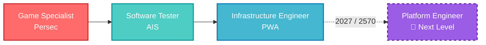
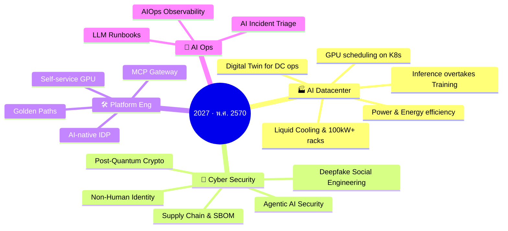
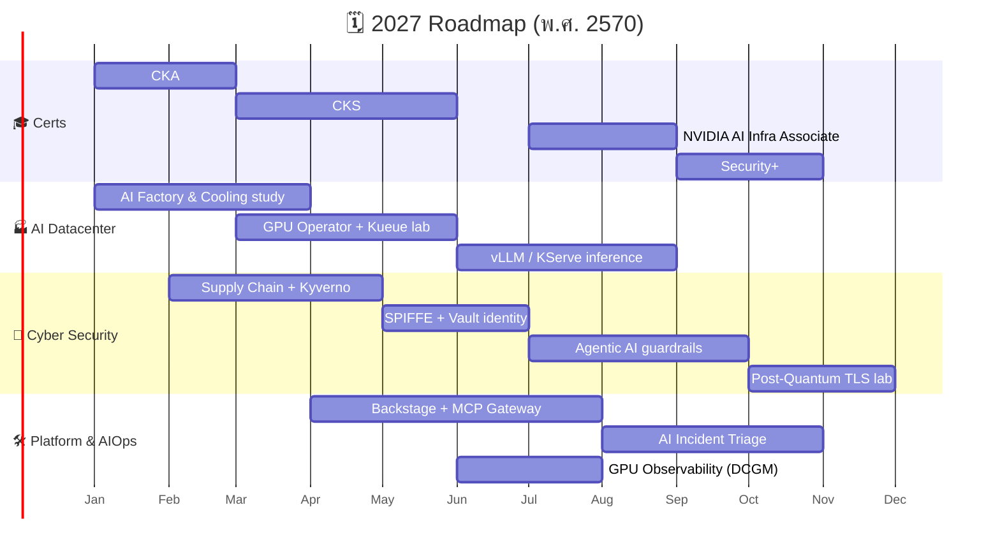
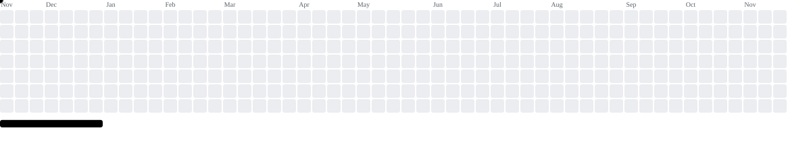
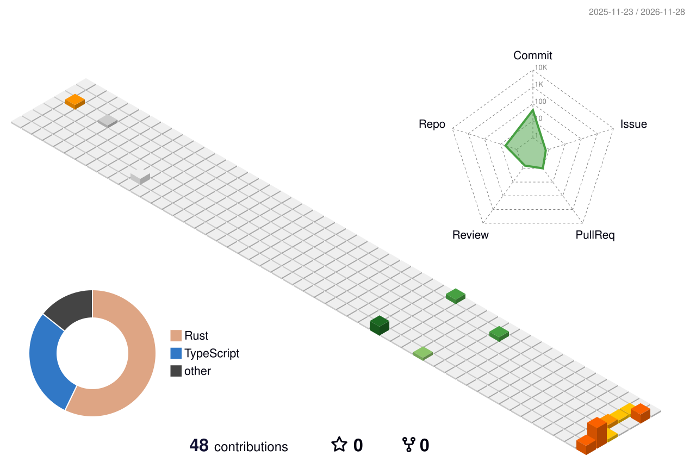

<div align="center">

<!-- Animated Typing Header -->


<p>
  <em>Bridging the gap between robust infrastructure and modern software development.</em>
</p>

<!-- Visitor Counter -->


<!-- Social Badges -->
<p>
  <a href="https://www.facebook.com/natiphong.jungin/" target="_blank">
    
  </a>
  <a href="mailto:natiphong.ju@gmail.com">
    
  </a>
  <a href="https://line.me/ti/p/cheeky4d">
    
  </a>
</p>


</div>

## 👨‍💻 About Me

```typescript
interface Engineer {
    role: string;
    location: string;
    company: string;
    background: string;
    currentFocus: string[];
    learning: string[];
    hobbies: string[];
    nextMilestone: { year: 2027; buddhistYear: 2570; target: string };
    sayHi: () => void;
}

const natiphong: Engineer = {
    role: "Infrastructure Engineer 🏗️",
    location: "Bangkok, Thailand 🇹🇭",
    company: "Provincial Waterworks Authority",
    background: "Software QA → Infrastructure",
    currentFocus: ["Data Center Optimization", "SAP Basis", "Kubernetes"],
    learning: ["React.js", "Next.js", "Advanced K8s Patterns"],
    hobbies: ["Automation 🤖", "System Architecture 📐", "Tech Exploration 🔍"],
    nextMilestone: { year: 2027, buddhistYear: 2570, target: "Platform Engineer 🛠️" },

    sayHi: () => console.log("Let's build something amazing together! 🚀"),
};

natiphong.sayHi();
```


## 🛠️ My Tech Stack

Here are the tools and technologies I use to build, deploy, and maintain systems.

### ☁️ Infrastructure & DevOps
<p>
  <a href="https://kubernetes.io/" target="_blank">  </a>
  <a href="https://www.docker.com/" target="_blank">  </a>
  <a href="https://helm.sh/" target="_blank">  </a>
  <a href="https://argo-cd.readthedocs.io/" target="_blank">  </a>
  <a href="https://aws.amazon.com" target="_blank">  </a>
  <a href="https://azure.microsoft.com" target="_blank">  </a>
  <a href="https://www.terraform.io/" target="_blank">  </a>
  <a href="https://www.ansible.com/" target="_blank">  </a>
  <a href="https://github.com/features/actions" target="_blank">  </a>
  <a href="https://www.linux.org/" target="_blank">  </a>
  <a href="https://www.nginx.com" target="_blank">  </a>
  <a href="https://grafana.com" target="_blank">  </a>
  <a href="https://prometheus.io" target="_blank">  </a>
</p>

### 🏢 Enterprise & Databases
<p>
  <a href="https://www.sap.com" target="_blank">  </a>
  <a href="https://www.oracle.com/" target="_blank">  </a>
  <a href="https://www.postgresql.org" target="_blank">  </a>
  <a href="https://www.mongodb.com/" target="_blank">  </a>
  <a href="https://redis.io" target="_blank">  </a>
  <a href="https://www.elastic.co" target="_blank">  </a>
</p>

### 💻 Development & Scripting
<p>
  <a href="https://www.python.org" target="_blank">  </a>
  <a href="https://golang.org" target="_blank">  </a>
  <a href="https://developer.mozilla.org/en-US/docs/Web/JavaScript" target="_blank">  </a>
  <a href="https://www.typescriptlang.org/" target="_blank">  </a>
  <a href="https://www.gnu.org/software/bash/" target="_blank">  </a>
  <a href="https://reactjs.org/" target="_blank">  </a>
  <a href="https://nextjs.org/" target="_blank">  </a>
  <a href="https://git-scm.com/" target="_blank">  </a>
</p>

### 🤖 AI & Machine Learning Tools
<p>
  <a href="https://openai.com" target="_blank">  </a>
  <a href="https://github.com/features/copilot" target="_blank">  </a>
  <a href="https://www.tensorflow.org" target="_blank">  </a>
  <a href="https://pytorch.org/" target="_blank">  </a>
  <a href="https://huggingface.co/" target="_blank">  </a>
</p>


## 💼 Professional Journey




## 🎯 Goals & Roadmap

<details>
<summary><b>📌 2026 (พ.ศ. 2569)</b> — click to expand</summary>
<br/>

```yaml
2026_goals:
  infrastructure:
    - "Advanced Kubernetes patterns & service mesh"
    - "Multi-cloud architecture (AWS, GCP, Azure)"
    - "Infrastructure security hardening"

  development:
    - "Master React.js & Next.js ecosystem"
    - "Build full-stack applications"
    - "Contribute to open-source projects"

  automation:
    - "CI/CD pipeline optimization"
    - "GitOps workflows with ArgoCD"
    - "Python automation scripts"
```

</details>

### 🚀 2027 (พ.ศ. 2570) — AI Datacenter × Cyber Security

> 🧭 **Theme:** จาก Infrastructure Engineer → Platform Engineer ที่ดูแล **โครงสร้างพื้นฐาน AI** ได้ และ **ปลอดภัยตั้งแต่ออกแบบ**

#### 📡 Trend Radar — สิ่งที่กำลังมาและน่าจับตา



| 🔥 Trend | ทำไมต้องสน | สิ่งที่จะลงมือทำ |
|---|---|---|
| 🏭 **AI Factory / Liquid Cooling** | rack สำหรับ AI กินไฟ 40–100+ kW, ระบบลมเดิมรับไม่ไหว | ศึกษา DLC / rear-door HX, PUE & capacity planning |
| 🎮 **GPU on Kubernetes** | AI workloads ย้ายมารันบน K8s มากขึ้น | NVIDIA GPU Operator, Kueue, MIG / time-slicing |
| ⚡ **Inference at scale** | คาดว่า inference จะแซง training ในไม่ช้า | Lab vLLM / KServe + autoscaling บน GPU |
| 🕵️ **Agentic AI Security** | AI agent ทำงานเองได้ → สิทธิ์เกิน, prompt injection | Guardrails, least-privilege สำหรับ agent, audit log |
| 🔑 **Non-Human Identity** | service account / agent / token เยอะกว่าคน | Workload identity (SPIFFE/SPIRE), Vault dynamic secrets |
| 🧬 **Post-Quantum Crypto** | "Harvest now, decrypt later" | Crypto inventory, ทดลอง ML-KEM / hybrid TLS |
| 📦 **Supply Chain Security** | ถูกโจมตีผ่าน dependency / image | SBOM, cosign, SLSA, admission policy |
| 🔌 **MCP Gateway** | IDP ถูกใช้งานผ่าน AI agent แทน portal | MCP server สำหรับ infra tools + RBAC |

#### 🎯 2027 Goals

```yaml
2027_goals:
  ai_datacenter:
    - "เข้าใจ AI Factory: power, liquid cooling, 40-100kW rack design"
    - "GPU cluster on K8s: NVIDIA GPU Operator, MIG, Kueue scheduling"
    - "Self-hosted LLM inference: vLLM / KServe + GPU autoscaling"
    - "DCIM + capacity planning dashboard (power / cooling / GPU usage)"

  cyber_security:
    - "Agentic AI security: guardrails, prompt-injection testing, agent RBAC"
    - "Non-human identity: SPIFFE/SPIRE + Vault dynamic secrets"
    - "Post-quantum readiness: crypto inventory + hybrid TLS (ML-KEM) lab"
    - "Supply chain: SBOM, cosign, SLSA L3, Kyverno admission policies"
    - "Runtime security: Falco / eBPF threat detection"

  platform_engineering:
    - "AI-native Internal Developer Platform (Backstage + MCP Gateway)"
    - "Golden paths: secure-by-default templates (Policy-as-Code)"
    - "Self-service GPU environment for data/AI teams"

  ai_ops:
    - "AI-assisted incident triage + LLM-powered runbooks"
    - "Observability for AI: OpenTelemetry + Grafana LGTM + GPU metrics (DCGM)"

  certifications:
    - "CKA → CKS"
    - "NVIDIA-Certified Associate: AI Infrastructure & Operations"
    - "CompTIA Security+ → CCSP"
```




## 📊 GitHub Stats

<div align="center">

<!-- github-readme-stats public instance ถูก pause (503) → ใช้ github-profile-summary-cards แทน -->


</div>

### 🐍 Contribution Snake

<div align="center">

<!-- Generated by .github/workflows/snake.yml → pushed to the `output` branch -->
<picture>
  <source media="(prefers-color-scheme: dark)" srcset="https://raw.githubusercontent.com/bom-sudo/bom-sudo/output/github-snake-dark.svg" />
  <source media="(prefers-color-scheme: light)" srcset="https://raw.githubusercontent.com/bom-sudo/bom-sudo/output/github-snake.svg" />
  
</picture>

<details>
<summary><b>🟡 Pac-Man mode</b> — click to unleash</summary>
<br/>

<picture>
  <source media="(prefers-color-scheme: dark)" srcset="https://raw.githubusercontent.com/bom-sudo/bom-sudo/output/pacman-contribution-graph-dark.svg" />
  <source media="(prefers-color-scheme: light)" srcset="https://raw.githubusercontent.com/bom-sudo/bom-sudo/output/pacman-contribution-graph.svg" />
  
</picture>

</details>

<details>
<summary><b>🧱 Breakout mode</b> — smash those commits</summary>
<br/>

<picture>
  <source media="(prefers-color-scheme: dark)" srcset="https://raw.githubusercontent.com/bom-sudo/bom-sudo/output/breakout-contribution-graph-dark.svg" />
  <source media="(prefers-color-scheme: light)" srcset="https://raw.githubusercontent.com/bom-sudo/bom-sudo/output/breakout-contribution-graph.svg" />
  
</picture>

</details>

<details>
<summary><b>🌈 Neon snake mode</b></summary>
<br/>


</details>

</div>

### 🏙️ 3D Contribution City

<div align="center">

<picture>
  <source media="(prefers-color-scheme: dark)" srcset="https://raw.githubusercontent.com/bom-sudo/bom-sudo/output/3d/profile-night-rainbow.svg" />
  <source media="(prefers-color-scheme: light)" srcset="https://raw.githubusercontent.com/bom-sudo/bom-sudo/output/3d/profile-season-animate.svg" />
  
</picture>

</div>


## 🎵 Spotify Playlist

<div align="center">

### What I'm Listening To 🎧

[](https://open.spotify.com/playlist/3QSWFaeoyqts5vXwlm62i5?si=5aab5dc978b34d8b)

> *Click to listen my coding playlist! 🎶*

</div>


## 📫 Let's Connect!

<div align="center">

### 💬 Ask me about

**Infrastructure** • **SAP Basis** • **Kubernetes** • **Platform Engineering** • **Testing Automation** • **DevOps Best Practices**

### 📧 Reach Out

<p>
  <a href="mailto:natiphong.ju@gmail.com">
    
  </a>
  <a href="https://line.me/ti/p/cheeky4d">
    
  </a>
</p>


---

<p>
  
</p>

</div>
